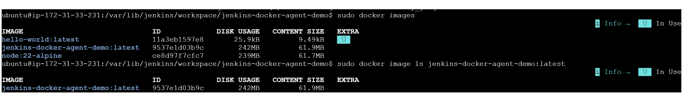
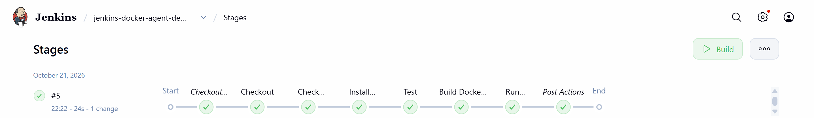
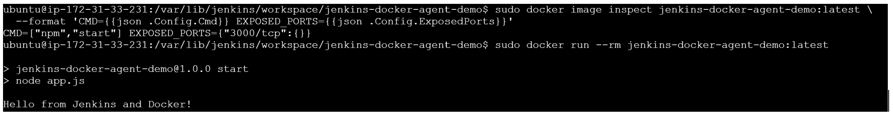
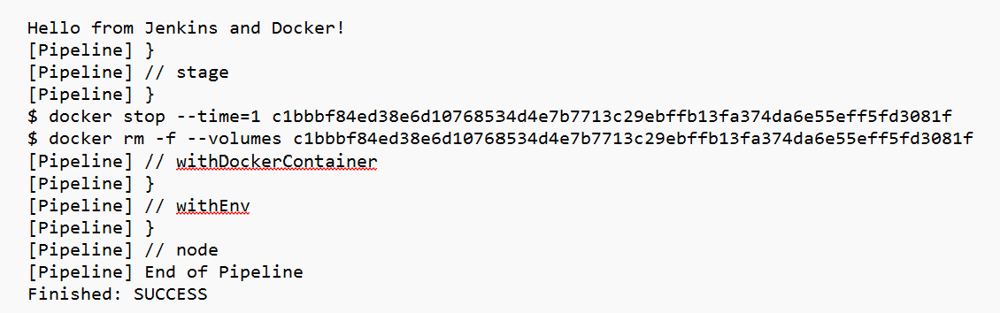

# Jenkins CI Pipeline with Docker

A hands-on DevOps project demonstrating how to automate a Node.js application's validation, testing, Docker image creation, and container execution using Jenkins and Docker.

## Project Overview

This project demonstrates a basic Continuous Integration (CI) workflow in which Jenkins checks out source code from GitHub, validates the Node.js environment, installs dependencies, runs tests, builds a custom Docker image, and verifies the application by running a container.

The pipeline is defined as code using a `Jenkinsfile`.

## Tech Stack

- **Jenkins** — CI pipeline automation
- **Docker** — Containerization and image building
- **Node.js 22** — JavaScript runtime
- **npm** — Dependency management and test execution
- **Git and GitHub** — Version control and source code management
- **Ubuntu on AWS EC2** — Jenkins host environment

## Architecture

```text
Developer
   |
   v
GitHub Repository
   |
   v
Jenkins Pipeline
   |
   +--> Checkout Source Code
   |
   +--> Verify Node.js and npm
   |
   +--> Install Dependencies
   |
   +--> Run Automated Tests
   |
   +--> Build Docker Image
   |
   +--> Run Container and Verify Logs
   |
   v
Successful CI Pipeline
```

## Pipeline Stages

### 1. Source Code Checkout
Jenkins retrieves the project files from the GitHub repository.

### 2. Node.js and npm Verification
Runs Node.js and npm commands inside a `node:22-alpine` Docker container without requiring Node.js to be installed directly on the Jenkins host.

### 3. Dependency Installation
Runs `npm ci` to install project dependencies.

### 4. Automated Testing
Executes `npm test` to validate the application's configured test command.

### 5. Docker Image Build
Builds a custom image using the project's Dockerfile.



```bash
docker build -t jenkins-docker-agent-demo:latest .
```

### 6. Container Execution Test
Runs a container from the custom image, checks its logs, and removes the temporary test container.



```bash
docker run -d --name jenkins-demo-test jenkins-docker-agent-demo:latest
docker logs jenkins-demo-test
docker rm -f jenkins-demo-test
```

## Dockerfile

The Dockerfile uses Node.js Alpine as the base image, sets the working directory, installs dependencies, copies the application, and defines the start command.

```dockerfile
FROM node:22-alpine

WORKDIR /app

COPY package*.json ./

RUN npm ci

COPY app.js ./

EXPOSE 3000

CMD ["npm", "start"]
```



## Successful Build Results

The pipeline completed successfully with the following results:

- Node.js version verification: Passed
- npm version verification: Passed
- Dependency installation: Passed
- Automated test: Passed
- Docker image build: Passed
- Container execution and log verification: Passed
- Jenkins build status: `SUCCESS`



**Application output:**

```text
Hello from Jenkins and Docker!
```

**Docker image:** `jenkins-docker-agent-demo:latest`

## What I Learned

- Writing and executing a declarative Jenkins pipeline
- Integrating Jenkins with a GitHub repository
- Running Node.js commands inside Docker containers
- Installing dependencies and executing tests through CI
- Building a custom Docker image from a Dockerfile
- Running containers and inspecting application logs
- Troubleshooting Jenkins and Docker execution issues on an Ubuntu server

## Future Improvements

- Push versioned Docker images to Docker Hub
- Configure automatic pipeline triggers on code changes
- Add stronger automated tests and test reporting
- Deploy the application to an AWS environment
- Add build notifications and pipeline status reporting

## Repository Contents

- `Jenkinsfile` — Jenkins pipeline definition
- `Dockerfile` — Docker image build instructions
- `app.js` — Node.js application
- `package.json` — Project metadata and npm scripts

---

**Project Type:** DevOps / Continuous Integration  
**Status:** CI pipeline and Docker image build verification completed successfully.
